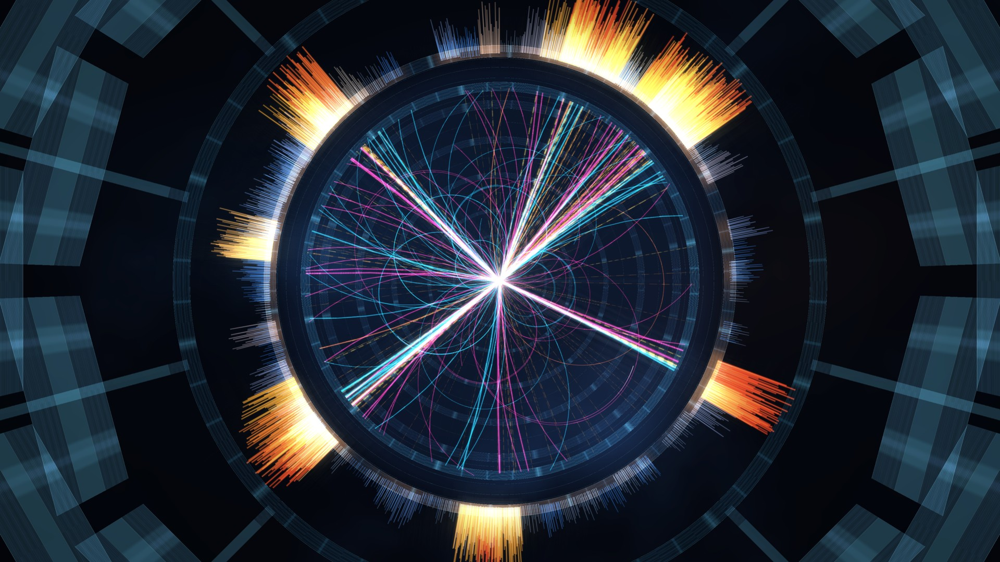

# Dirac: the Loom Collider



**One proton collision in X3D, slowed 330 million times.** A time-dilation dial runs it from a thousandth of demo speed through zero into reverse, a score follows the clock like a tape, and the camera tours the detector on its own until you take it.

It is a demo, not a physics study. The events are real generator output (Pythia 8.318, proton on proton at 13.6 TeV), the detector response is a truth-level toy, and the effort goes into the graphics: every particle is drawn with its own animated shader look. The scenes are still ones a machine can be held accountable to. They are generated by the Loom scene builder, never hand-edited, and the Loom hep-event witness passes on them.

**Open it:** the GitHub Pages site of this repository, or run it locally (below). It needs WebGL and a browser with hardware acceleration.

## What you can do

| control | action |
|---|---|
| Time dilation | drag through zero to stop time or run it backwards; × 1 is 3.0 ns of the collision per screen second |
| Collision clock | scrub to any moment; arrow keys step it |
| Auto-tour (T) | a 54-second camera loop on its own clock, so stopping time gives bullet time |
| Drag, scroll, pinch | take the camera: orbit the vertex and zoom; double-click hands it back to the tour |
| End-on, Three-quarter, Side | fly to a fixed shot |
| Glow (G) | the bloom pass on or off |
| Render quality | the glow pass's render target height, from 720 to 2160 rows; Adaptive drops from 1080 to 720 on a slow device |
| Exposure, Bloom | tune the glow pass live |
| Save 4K frame | one 3840 × 2160 still with the event held |
| Dijet, Z → μμ | two events: a hard two-jet event, and a Z boson decaying to two muons that are drawn on through the muon system |
| Sound on (M), Follows time | the score; with Follows time on it slows, drops in pitch and plays backwards with the clock |
| Labels (L), Fullscreen (F), Hide controls (H) | presentation |

## Run it locally

Serve the folder over HTTP; opening `index.html` as a file blocks the scene and audio loads.

```bash
python3 serve.py              # then open http://localhost:8000/
```

On Windows double-click `launch-windows.bat`; under WSL run `bash launch-wsl.sh`. Python 3 is the only requirement.

## What is checked, and what is not

| claim | evidence | grade |
|---|---|---|
| every visible particle is drawn exactly once, bends the right way for its charge and momentum, starts at its vertex and stays inside the detector | the Loom hep-event witness passes on these scenes (`evidence/hep-event.json`); the traps witness passes too (`evidence/traps.json`) | C |
| the scenes here are the witnessed ones | `scenes/dijet.xml` and `scenes/zmumu.xml` are byte-identical to the witnessed builds in `evidence/scenes.sha256`; the Pages workflow checks this before every deploy | C |
| the look is close to the reference still | dijet end-on with glow: mean luma 0.170 against 0.190, blue 63% against 63%, cyan 12% against 9%; red is still short (2.7% against 7.5%) (`docs/frames/stats.json`) | C for the numbers, S for "beautiful" |
| frame rate | not measured here; the page shows the frame rate on your own device | none |

The glow files (`scenes/*.glow.xml`) wrap the witnessed scene in a RenderedTexture and a bloom shader; they add no geometry. The physics is plausible, not exact: tolerances are loose, there are no mass-shell or calorimeter sum rules, and the detector is a toy.

## How it was made

The scene builder, the witness, its controls and the comparison frames live in the Loom repository (`hagopjay/x3d.loom`, `COLLIDER.md` and `docs/COLLIDER-LOOK-V3.md`). This is look v3: the Loom's look v2 folded together with the best of an outside fidelity pass, which gave the tighter ribbon cores that scale with the render size, the machined detector shell, the flash's shock ring, the haze shafts, the multiscale bloom and the optics tools. `docs/frames/compare_dijet.jpg` and `compare_zmumu.jpg` set look v2, the outside pass and look v3 side by side.

`manifest.json` lists every file with its size and SHA-256, the source fixtures and the score loops.

## Third-party parts

- X_ITE 16.5.1, the X3D browser (MIT, `x_ite/LICENSE.md`), a subset hosted here.
- Big Shoulders Display and IBM Plex Mono (SIL Open Font License 1.1, `fonts/`), and PT Sans, shipped with X_ITE (OFL, `x_ite/assets/fonts/PT_Sans/OFL.txt`).
- Events generated with Pythia 8.318.
- The score was generated from a style prompt (cinematic orchestral, pulsing tremolo build into a sub-bass impact) and cut into 24-second loops so the impact lands on every second flash.
